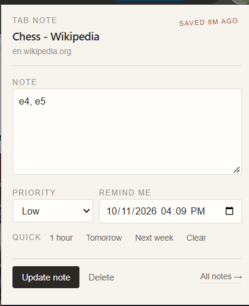
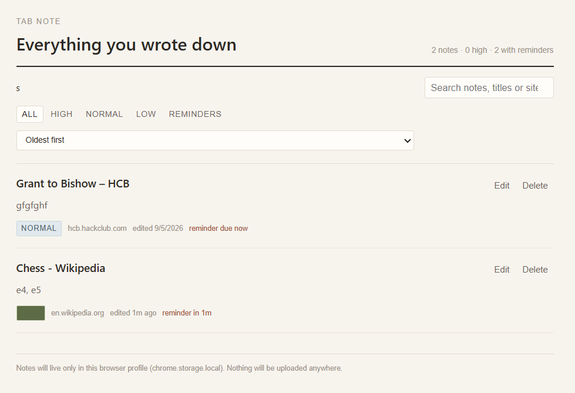

# Tab Note
Tab Note is a simple Chrome extension that lets us save a short note about any web page that we visit .
Sometimes we save a page because we think we will need it late but after a few weeks we  forget why we saved it. Tab Note helps with this problem. we can write a note, set a priority and add a reminder so we can remember why the page is important and we saved that.


## Images 



---



## Features

- It saves one note for each webpage that we save
- Notes are saved using the page URL
- In this URL anchors (`#something`) are removed to avoid duplicate notes 
- It sets note priority:
  - Low
  - Normal
  - High
- It Sets a reminder for a specific date and time what we need
- It set reminders for this way:
  - 1 hour
  - Tomorrow
  - Next week
- wWe can Get a Chrome notification when a reminder is due
- we can  see a small colored dot on the extension icon when the  page that we are using has a note
- That Dot color shows the note priority of the page
- We can open a dashboard to see all our notes
- we can search notes by text, page title, or URL
- In this extension notes are filters by priority
- it show only notes that have reminders
- It sort notes by:
  - Recently edited
  - Oldest
  - Priority
  - Website
- we cab eddit notes directly from the dashboard
- also we can delete notes from the dashboard
- we can get helful messages when there are no notes

  ## Installation

Here is how you can downoad this project

1. Download or clone this project.
2. Open Chrome.
3. Go to `chrome://extensions`.
4. Turn on **Developer mode**.
5. Click **Load unpacked**.
6. Select the folder that contains `manifest.json`.
7. Pin Tab Note to your Chrome toolbar.

Tab Note should also work in other Chromium-based browsers such as Edge and Brave.

### Updating the Extension

If you change any extension files you can do this :

1. Open `chrome://extensions`.
2. Find **Tab Note**.
3. Click the **Reload** button.

## How to Use

1. Open any `http` or `https` web page.
2. Click the **Tab Note** icon in the browser toolbar.
3. Write a note about the page.
4. Choose a priority.
5. Add a reminder if you need one.
6. Save the note.

You can also save a note using:

- **Cmd + Enter** on Mac
- **Ctrl + Enter** on Windows/Linux


## Dashboard

The dashboard lets us manage all your saved notes in one place.

we can:

- Search notes
- Filter by priority
- Show only notes with reminders
- Sort notes
- Edit notes
- Delete notes

we can search for:

- A word from your note
- A website name
- A page title
- Part of a URL

## Reminders

we can add a reminder to our any note.

We can either choose a specific date and time or use a quick reminder button:

- **1 hour**
- **Tomorrow**
- **Next week**

When the reminder is due then  Chrome will show a notification.

## Where Are Notes Stored?

Tab Note stores all notes locally in our browser using:
`chrome.storage.local`

our notes are not uploaded to a server.

Tab Note does not use:

- An account system
- A backend server
- Network requests
- Cloud storage
- Automatic syncing

Our notes stay inside the browser profile where you installed the extension.

**Important:** If we remove the extension, the stored notes will also be removed. Make sure to export or copy anything important before uninstalling the extension.

## Permissions

 This extension uses these Chrome permissions:

- **activeTab** – to access the current web page
- **tabs** – to read the current page URL and title
- **storage** – to save notes locally
- **alarms** – to schedule reminders
- **notifications** – to show reminder notifications

## Project Structure

```text
manifest.json    Chrome extension configuration
popup.html       Popup interface
popup.css        Popup styles
popup.js         Popup logic for creating and editing notes

notes.html       Notes dashboard
notes.css        Dashboard styles
notes.js         Search, filters, sorting and editing

storage.js       Shared storage and URL functions
background.js    Handles badges and reminder alarms

shared.css       Shared styles
icon.png         Extension icon
svg/             SVG files
```

## Technology

TabNote is built with simple web technologies Like this :

- HTML
- CSS
- JavaScript

There is no:

- Framework
- Build step
- Server
- Database
- Account system

Everything runs directly in the browser.

## Privacy

Tab Note is designed to keep our notes private.
our notes are stored locally in our browser and they are not sent to any external server.
There is no backend or cloud storage.

## Project Name

This project was originally designed with the name **Page Notes Companion**.
however the extension name is **Tab Note**.
